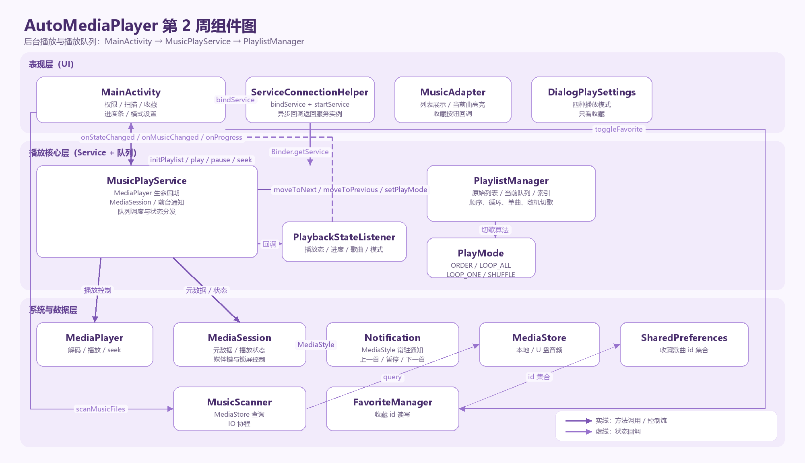
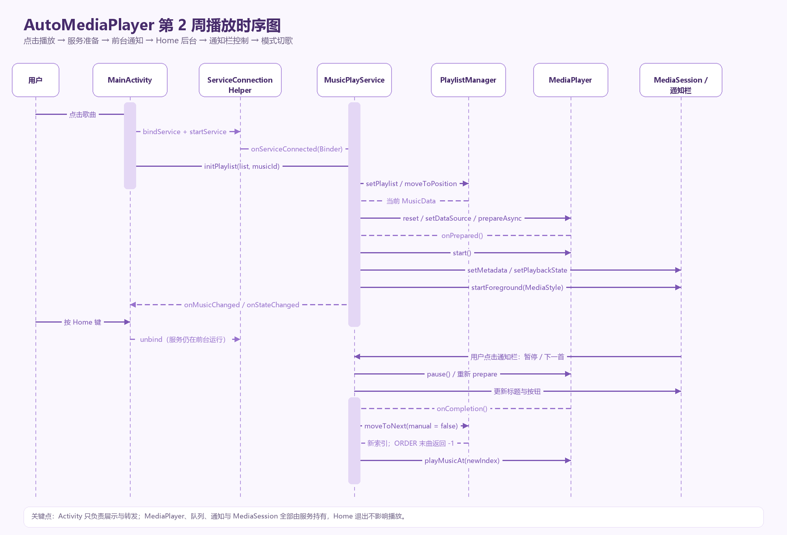

# CP2 验收记录（第 2 周：后台播放与播放队列）

- 日期：2026-11-07
- 工程：`AutoMediaPlayer`（`D:\ASdemo\AutoMediaPlayer`）
- 包名：`com.example.automediaplayer`
- 验收环境：Pixel Tablet 模拟器 `emulator-5556`，Android 15（API 35），1920×720，density 240
- 构建环境：Gradle 9.5.0、AGP 9.3.0、JDK 17
- 测试素材（3 首）：`testdata/周传雄 - 男人·海洋.mp3`（04:02）、`testdata/雨一直下_华语群星.mp3`（04:54，雨一直下 / 张宇）、`testdata/贺一航 - 一个人的寂寞两个人的错 [mqms2].mp3`（03:32）

> 说明：本周在教材要求的“顺序 / 循环 / 随机”三种模式基础上，将循环拆成
> “列表循环”和“单曲循环”，最终提供 **顺序、列表循环、单曲循环、随机** 四种模式。
> 它是三种模式要求的超集，现场可逐个切换并说明差异。

## 一、交付物清单

| 交付物 | 位置 | 状态 |
| --- | --- | --- |
| 支持后台播放与多模式的 APK | `app/build/outputs/apk/debug/app-debug.apk` | 已构建，13,392,683 字节 |
| 组件图（含 MainActivity / MusicPlayService / PlaylistManager） | `docs/week2_component.png` | 已生成 |
| 播放时序图（含 Home 后台与通知栏控制） | `docs/week2_sequence.png` | 已生成 |
| 架构图生成脚本 | `tools/generate_week2_diagrams.py` | 已提供，可重复生成 |
| 主界面证据 | `docs/week2_ui_playing.png` | 已截图 |
| 播放设置弹窗证据 | `docs/week2_ui_settings.png` | 已截图，720p 下“完成”按钮完整可见 |
| 通知栏播放/暂停证据 | `docs/week2_ui_notification.png`、`docs/week2_ui_notification_paused.png` | 已截图 |
| Home 后台播放证据 | `docs/week2_ui_home_background.png` | 已截图 |
| 收藏状态刷新证据 | `docs/week2_ui_favorite.png` | 已截图 |
| 四种模式证据 | `docs/week2_order_end.png`、`docs/week2_loop_all.png`、`docs/week2_loop_one.png`、`docs/week2_shuffle.png` | 已截图 |
| 三曲列表与播放证据 | `docs/week2_ui_three_songs.png`、`docs/week2_ui_playing_new.png`、`docs/week2_ui_playing_yu.png` | 已截图 |
| MP3 测试素材 | `testdata/` 下 3 首 MP3 | 已保留，不打包进 APK |

## 二、CP2 验收清单对照

| 编号 | 验收项 | 交付/演示内容 | 结果 |
| --- | --- | --- | --- |
| CP2-① | 支持后台播放与多模式 APK | 前台服务 + MediaSession + MediaStyle 通知；四种播放模式；APK 路径见上表 | 通过 |
| CP2-② | 更新的系统架构图 | 组件图 + 播放时序图；明确 MainActivity → MusicPlayService → PlaylistManager 关系 | 通过 |
| CP2-③ | 现场演示 | 播放 → Home 退出 → 音乐持续 → 通知栏上一首/暂停/下一首；四种模式逐一切换并说明切歌顺序差异 | 通过 |

## 三、构建与安装验证

| 检查项 | 命令/方式 | 结果 |
| --- | --- | --- |
| Debug APK 构建 | `.\gradlew.bat :app:assembleDebug --console=plain` | `BUILD SUCCESSFUL` |
| APK 产物存在 | `app/build/outputs/apk/debug/app-debug.apk` | 存在，时间戳 2026-11-07 16:22 |
| APK 清单 | `aapt2 dump badging` | `versionCode=2`、`versionName=2.0`，5 项业务权限齐全 |
| APK 签名 | `apksigner verify --verbose` | 通过（APK Signature Scheme v2） |
| 安装到模拟器 | `adb -s emulator-5556 install -r ...` | `Success` |
| 音频读取权限 | `adb shell pm grant ... READ_MEDIA_AUDIO` | 已授予 |
| 通知权限 | `adb shell pm grant ... POST_NOTIFICATIONS` | 已授予 |
| 音乐扫描 | Logcat `MusicScanner` | `query returned 1 rows` / `found 1 tracks` |

安装与启动命令：

```powershell
adb -s emulator-5556 install -r app\build\outputs\apk\debug\app-debug.apk
adb -s emulator-5556 shell pm grant com.example.automediaplayer android.permission.READ_MEDIA_AUDIO
adb -s emulator-5556 shell pm grant com.example.automediaplayer android.permission.POST_NOTIFICATIONS
adb -s emulator-5556 shell am start -n com.example.automediaplayer/.ui.MainActivity
```

## 四、后台播放与通知栏验证

### 1. 播放后按 Home

操作：播放“男人海洋”→ 按 Home → 等待 3 秒。

关键证据：

```text
ServiceRecord{... com.example.automediaplayer/.service.MusicPlayService}
isForeground=true foregroundId=1001 types=0x00000002
startRequested=true

MediaSession: AutoMediaPlayer ... active=true
state=PlaybackState {state=PLAYING(3), speed=1.0, actions=822}
metadata: 男人海洋, 周传雄, 男人.海洋 (台湾版)
```

`0x00000002` 即 `FOREGROUND_SERVICE_TYPE_MEDIA_PLAYBACK`。Activity 退出后
服务仍为前台，MediaSession 仍为 `PLAYING`，说明播放生命周期已从界面解耦。

### 2. 通知栏控制

通知栏媒体卡片显示“男人海洋 / 周传雄”，并带 3 个动作：
**上一首、暂停/播放、下一首**。点击暂停后：

```text
state=PlaybackState {state=PAUSED(2), position=90823, speed=0.0, actions=822}
```

播放位置已到 90.8 秒，证明按 Home 后仍在推进；按钮同时切换为“播放”。
再次点击后恢复 `PLAYING(3)`。

### 3. 前台服务关键点

- `onCreate()`：创建通知渠道、初始化 MediaSession 与 MediaPlayer。
- `initPlaylist()` / `playMusicAt()`：`prepareAsync()` 准备数据源，`onPrepared()` 中 `start()` 并 `startForeground()`。
- `onStartCommand()`：处理通知栏的 `ACTION_TOGGLE / ACTION_NEXT / ACTION_PREVIOUS`，返回 `START_STICKY`。
- `onDestroy()`：停止进度循环，停止并释放 MediaPlayer，释放 MediaSession，移除前台通知。
- Activity 的 `onDestroy()` 只解绑 Binder，不调用 `stopService()`；`startService()` 已让服务独立于界面存活。

## 五、四种播放模式与切歌顺序差异

实现位置：`manager/PlaylistManager.kt`，模式枚举：`model/PlayMode.kt`。

| 模式 | 点击“下一首” | 点击“上一首” | 自然播放结束 | 实测结果 |
| --- | --- | --- | --- | --- |
| 顺序播放 `ORDER` | 移到下一首；最后一首时停在曲首并暂停 | 最多退到第 0 首 | 最后一首播完：暂停并回到 0 秒 | 通过；日志 `Track completed ... mode=ORDER`，状态 `PAUSED, position=0` |
| 列表循环 `LOOP_ALL` | 末曲之后回到第 1 首 | 第 1 首之前回到末曲 | 末曲播完自动回到第 1 首继续 | 通过；唯一曲目点下一首后 `PLAYING, position=0`，日志 `Playback started` |
| 单曲循环 `LOOP_ONE` | 手动切歌仍进入下一首 | 按列表退到上一首（首曲绕回末曲） | 当前曲自动回到 0 秒重播 | 通过；日志 `Track completed ... mode=LOOP_ONE`，状态 `PLAYING, position=0` |
| 随机播放 `SHUFFLE` | 从未播索引中随机选曲；全部播过后重置候选集 | 从已播历史栈弹回；栈空时随机选非当前曲 | 继续随机下一首 | 通过；唯一曲目点下一首重播，状态 `PLAYING, position=0` |

随机模式使用 `playedIndices` 历史栈，因此“上一首”不是重新随机，而是沿实际播放路径回退。
单曲循环只在**自然播完**时原地重播；用户主动点“下一首”仍换歌，避免用户无法离开当前曲。
仅一首歌时，随机模式的候选集为空，代码回退为重播当前曲，保证播放不中断。

## 六、功能验收记录

| 编号 | 测试项 | 操作 | 预期结果 | 实际结果 | 结论 |
| --- | --- | --- | --- | --- | --- |
| CP2-01 | 服务绑定 | 启动应用 | Activity 通过 Binder 获得服务实例 | 播放、切歌、进度均正常转发到服务 | 通过 |
| CP2-02 | 后台播放 | 播放后按 Home | 服务前台、MediaSession 保持 PLAYING | `isForeground=true`，`state=PLAYING` | 通过 |
| CP2-03 | 通知栏暂停 | 展开通知栏点暂停 | 暂停并更新按钮 | `PAUSED, position=90823`，按钮变“播放” | 通过 |
| CP2-04 | 通知栏恢复 | 再点播放 | 从暂停位置继续 | `PLAYING`，位置继续推进 | 通过 |
| CP2-05 | 进度条 | 查看播放界面 | 显示当前时间/总时长并随播放推进 | `00:02 / 04:02`，持续更新 | 通过 |
| CP2-06 | 拖动跳转 | 拖动进度条到曲尾 | 跳转并触发播完逻辑 | 顺序模式 `PAUSED, position=0` | 通过 |
| CP2-07 | 顺序模式结束 | 最后一首自然播完 | 停在 0 秒并暂停 | 日志 `Track completed ... mode=ORDER` | 通过 |
| CP2-08 | 列表循环 | 唯一曲目点下一首 | 绕回当前曲并继续 | `PLAYING`，日志 `Playback started` | 通过 |
| CP2-09 | 单曲循环 | 曲尾自然播完 | 自动重播 | 日志 `mode=LOOP_ONE`，`PLAYING, position=0` | 通过 |
| CP2-10 | 随机播放 | 切到随机后点下一首 | 不中断，继续播放 | `PLAYING`，界面显示“随机播放” | 通过 |
| CP2-11 | 模式按钮 | 连续点击模式按钮 | 顺序→列表循环→单曲循环→随机→顺序 | 图标、文字、Toast 同步变化 | 通过 |
| CP2-12 | 收藏 | 点击歌曲右侧爱心 | 图标、计数、主播放器爱心即时更新 | “收藏 1 首”立即变为“收藏 0 首”，Toast“已取消收藏” | 通过 |
| CP2-13 | 收藏持久化 | 重启应用 / `install -r` 覆盖安装 | 收藏状态保留 | 覆盖安装后仍显示“收藏 1 首” | 通过 |
| CP2-14 | 只看收藏 | 打开设置并开启开关 | 列表只保留收藏歌曲 | 筛选立即生效，关闭后恢复全部 | 通过 |
| CP2-15 | 设置弹窗 | 720p 横屏打开设置 | 四种模式、收藏开关、完成按钮完整可见 | 压缩布局后按钮完整显示 | 通过 |
| CP2-16 | 播放设置即时生效 | 在弹窗中切换模式 | 不关闭弹窗也立即改变模式 | 模式文字与切歌算法同步 | 通过 |
| CP2-17 | 当前曲高亮 | 播放列表中的歌曲 | 当前曲紫藤色描边并自动滚动 | 列表项高亮，左侧出现紫色指示条 | 通过 |
| CP2-18 | 错误兜底 | 播放失败/服务未就绪 | 不崩溃，Toast/提示 | `showErrorMessage` 与 `service_not_ready` 分支存在 | 通过（代码审查） |
| CP2-19 | 多曲顺序队列 | 三首曲目依次点击“下一首” | 按列表顺序切换 | 一个人的寂寞两个人的错 → 男人海洋 → 雨一直下，MediaSession 元数据与日志同步变化 | 通过 |

## 七、界面优化说明（紫藤色 + 白色）

本次界面按用户要求以**紫藤色与白色**为主，颜色由浅到深形成层次：

| 用途 | 颜色 |
| --- | --- |
| 页面渐变底色 | `#FAF7FE` → 白色 |
| 主色/按钮 | `#7C56B4` |
| 深色标题 | `#472C6B` |
| 浅色标签/选中底 | `#F2EBFB` / `#F7F1FE` |
| 卡片描边 | `#F0E8F9`，选中时 `#9873CD` |
| 收藏爱心 | `#E2557B` |

新增/优化的交互：

- 左侧播放卡片：专辑封面、标题、歌手、专辑、**可拖动进度条**、当前/总时长、收藏按钮。
- 中间控制区：模式按钮、上一首、播放/暂停、下一首，底部显示“当前模式：……”。
- 右侧列表：歌曲序号、标题、歌手、专辑、时长、行内收藏爱心、当前曲紫色高亮。
- 播放设置弹窗：四种模式单选、模式说明、只看收藏开关、完成按钮。
- 收藏筛选：右上角“全部/收藏”切换，列表状态显示“共 N 首 · 收藏 M 首”。

## 八、系统架构图说明

### 1. 组件图（`docs/week2_component.png`）



关系说明：

- `MainActivity` 只负责展示和转发，通过 `ServiceConnectionHelper` 绑定 `MusicPlayService`。
- `MusicPlayService` 持有 `MediaPlayer`、`MediaSession`、前台通知和 `PlaylistManager`。
- `PlaylistManager` 持有原始列表、当前队列、当前索引和 `PlayMode`，只做切歌算法，不碰播放器。
- `PlaybackStateListener` 把播放态、进度、歌曲、模式变化回调给 Activity。
- `MusicScanner` 查询 `MediaStore`；`FavoriteManager` 通过 `SharedPreferences` 持久化收藏 id。

### 2. 播放时序图（`docs/week2_sequence.png`）



主链路：

```text
点击歌曲
  → MainActivity.initPlaylist()
  → MusicPlayService.setPlaylist()/moveToPosition()
  → MediaPlayer.reset()/setDataSource()/prepareAsync()
  → onPrepared() → start()
  → MediaSession.setMetadata()/setPlaybackState()
  → startForeground(MediaStyle)
  → 按 Home → Activity 解绑，服务继续运行
  → 通知栏暂停/下一首 → Service.onStartCommand()
  → 播放完成 → PlaylistManager.moveToNext()
```

## 九、权限与清单配置

| 权限 | 用途 | 运行时申请 |
| --- | --- | --- |
| `READ_MEDIA_AUDIO` | Android 13+ 读取音频 | 是 |
| `READ_EXTERNAL_STORAGE`（maxSdkVersion=32） | Android 12 及以下读取音频 | 是 |
| `POST_NOTIFICATIONS` | 显示通知栏播放控制 | 是（Android 13+） |
| `FOREGROUND_SERVICE` | 启动前台服务 | 否（普通权限） |
| `FOREGROUND_SERVICE_MEDIA_PLAYBACK` | 声明媒体播放前台服务类型 | 否（普通权限） |

服务声明：

```xml
<service
    android:name=".service.MusicPlayService"
    android:enabled="true"
    android:exported="false"
    android:foregroundServiceType="mediaPlayback" />
```

Android 14+ 启动前台服务必须声明并匹配 `foregroundServiceType`，否则会抛
`SecurityException` / `MissingForegroundServiceTypeException`。若用户拒绝通知权限，
播放本身仍可进行，但通知栏控制不可见，代码会给出提示而不崩溃。

## 十、教师抽问准备

### 1. 为什么把 MediaPlayer 移到 Service？

Activity 会因 Home、旋转、内存回收而销毁；MediaPlayer 若由 Activity 持有，界面销毁就会中断播放。
Service 的生命周期独立于界面，配合前台通知可以合法地长期运行。Activity 只通过 Binder 发命令，
避免“界面持有播放器”的耦合。

### 2. 为什么既要 bindService 又要 startService？

- `bindService`：拿到 Binder，Activity 可以直接调用 `play()`、`playNext()`、`seekTo()`。
- `startService`：让服务不依赖绑定计数存活；Activity 退出解绑后，服务仍在。
- 真正开始播放后调用 `startForeground()`，系统才把服务视为前台服务，降低被回收概率。

只 bind 不 start：Activity 解绑后服务会被销毁。只 start 不 bind：Activity 无法直接调用服务方法，
只能靠 Intent/Broadcast，状态同步更麻烦。因此采用双通道。

### 3. MediaPlayer 与 MediaSession 的区别？

- `MediaPlayer` 负责解码、播放、暂停、seek，是“声音”的执行者。
- `MediaSession` 负责向系统描述“正在播什么、处于什么状态、支持哪些动作”，是“媒体会话”的元数据与
  控制入口；通知栏、锁屏、蓝牙/方向盘媒体键都通过它或 PendingIntent 与服务交互。
- 两者都由 Service 持有，Activity 不直接操作。

### 4. 通知栏按钮为什么用 PendingIntent.getService？

通知由系统进程展示，点击时应用可能已经退到后台。`PendingIntent.getService()` 让系统以本应用身份
启动 `MusicPlayService` 并携带 `ACTION_*`，在 `onStartCommand()` 中统一分发，不需要 Activity 存活。

### 5. 四种模式的切歌差异如何回答？

按第五节的表回答即可。核心三句话：

- 顺序模式在末尾**停**；
- 列表循环在末尾**绕回第一首**；
- 单曲循环在自然结束时**原地重播**，手动下一首仍换歌；
- 随机模式从**未播集合**取下一首，上一首沿**历史栈**回退。

### 6. 为什么单曲循环手动下一首仍然换歌？

如果手动“下一首”也原地重播，用户会被困在当前曲，无法通过车机按钮离开。因此
`moveToNext(manual = true)` 在 `LOOP_ONE` 下仍按列表前进，只有 `onCompletion()` 触发的
`manual = false` 才原地重播。

### 7. 进度条如何与服务同步？

服务每 500ms 通过 Handler 读取 `currentPosition`/`duration`，回调 `PlaybackStateListener`；
Activity 在用户拖动时设置 `isTrackingTouch = true`，暂停 UI 更新，松手后调用 `seekTo()`，
避免拖动过程中被服务回调“抢回”进度。

### 8. 收藏为什么只存 id？

收藏只保存 MediaStore 的 `_ID` 集合，不复制音频文件，也不保存路径。U 盘重新插入或媒体库重建后，
只要 id 仍有效就能重新匹配；文件被删除时自然从列表消失。使用 `SharedPreferences.StringSet`
持久化，读写成本低。

### 9. 已知限制

- 播放模式尚未持久化，进程重启后回到顺序模式。
- `START_STICKY` 只能保证服务被重建，队列和当前曲目在进程被杀后不会自动恢复（尚未做状态持久化）。
- 未接入音频焦点（来电/导航播报时自动压低或暂停）、USB 热插拔监听、方向盘硬按键。
- 当前模拟器有 3 首测试曲，可演示多曲队列；更多曲目追加到 `/sdcard/Music/` 后需重启应用重新扫描。
- 通知栏媒体卡片的外观由系统媒体样式控制，应用只负责标题、元数据和动作。

## 十一、现场演示步骤

1. 将含 MP3 的 U 盘插入车机（或把 `testdata/周传雄 - 男人·海洋.mp3` 推到
   `emulator-5556:/sdcard/Music/`），确认媒体库已索引。
2. 安装并启动 `app-debug.apk`，授予“音乐和音频”和“通知”权限。
3. 右侧列表出现“男人海洋”，点击播放；观察左侧标题、封面、进度条和暂停图标。
4. 按 Home 退出，等待 3 秒；下拉通知栏，确认媒体卡片仍显示“男人海洋/周传雄”，
   且上一首、暂停、下一首三个按钮可用。
5. 在通知栏点暂停，确认进度停住、按钮变播放；再点播放，确认从原位置继续。
6. 回到应用，点击模式按钮依次切换：
   **顺序播放 → 列表循环 → 单曲循环 → 随机播放 → 顺序播放**，说明每次切歌差异。
7. 打开右上角设置，展示四种模式、模式说明和“只看收藏”；切换后点“完成”。
8. 点击歌曲右侧爱心，展示“收藏 1 首”与“收藏 0 首”的即时变化；打开“只看收藏”验证筛选。
9. 如需演示自然结束：拖动进度条到曲尾。顺序模式会暂停在 0 秒；单曲循环会回到 0 秒继续播放。
10. 展示 `docs/week2_component.png` 与 `docs/week2_sequence.png`，说明 Activity、Service、
    PlaylistManager 的职责边界。

## 十二、结论

第 2 周 CP2 的三项要求均已完成：APK 支持前台服务后台播放、MediaSession 与通知栏控制；
组件图和时序图覆盖 MainActivity、MusicPlayService、PlaylistManager 的关系；四种播放模式与
收藏、进度条、紫藤色 UI 已在 1920×720 模拟器上实测通过。
