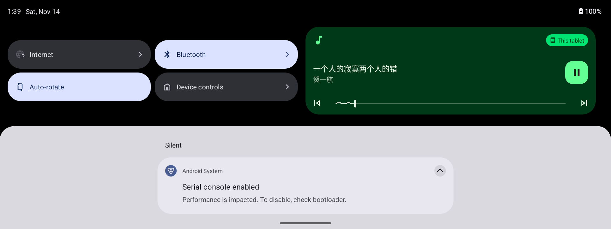
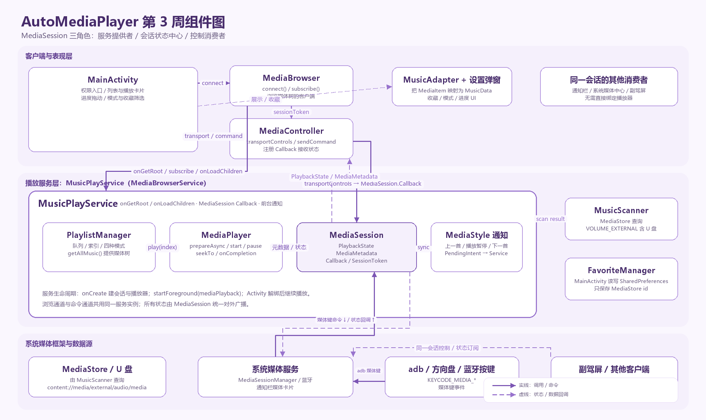
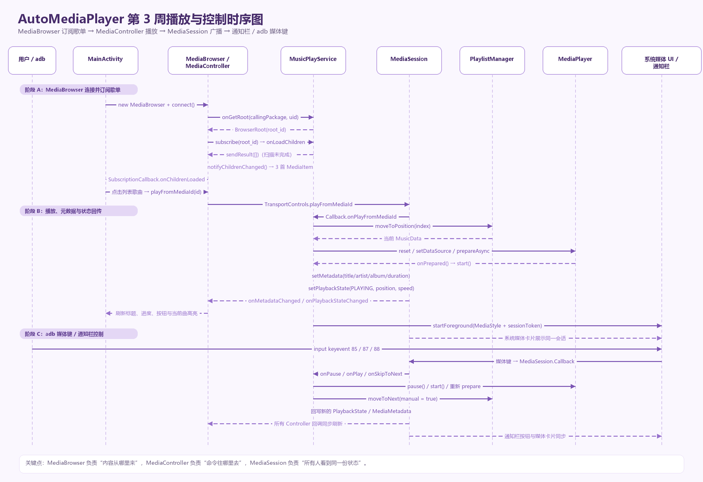

# CP3 验收记录（第 3 周：MediaSession 与多屏协同基础）

- 日期：2026-11-14
- 工程：`AutoMediaPlayer`（`D:\ASdemo\AutoMediaPlayer`）
- 包名：`com.example.automediaplayer`
- 版本：`versionCode=3`、`versionName=3.0`
- 验收环境：Pixel Tablet 模拟器 `emulator-5556`，Android 15（API 35），1920×720，density 240
- 构建环境：Gradle 9.5.0、AGP 9.3.0、JDK 17
- 测试素材（3 首）：`testdata/周传雄 - 男人·海洋.mp3`、`testdata/雨一直下_华语群星.mp3`、`testdata/贺一航 - 一个人的寂寞两个人的错 [mqms2].mp3`

> 结论：CP3 的 ①MediaBrowserService 版 APK、②新架构图、③adb 媒体键控制与抽问材料均已完成。
> 第 2 周的后台播放、四模式、进度条、收藏和通知栏能力均在 MediaSession 版本中保留。

## 一、交付物清单

| 交付物 | 位置 | 状态 |
| --- | --- | --- |
| MediaBrowserService 版 APK | `app/build/outputs/apk/debug/app-debug.apk` | 已构建，12,394,891 字节，2026-11-14 09:47 |
| 组件图（含 MediaSession / MainActivity / MusicPlayService） | `docs/week3_component.png` | 已生成 |
| 播放与控制时序图 | `docs/week3_sequence.png` | 已生成 |
| 架构图生成脚本 | `tools/generate_week3_diagrams.py` | 已提供，可重复生成 |
| MediaBrowser 初始歌单 | `docs/week3_ui.png` | 已截图 |
| MediaBrowser 主界面 | `docs/week3_ui_playing.png` | 已截图 |
| 后台通知栏媒体卡片 | `docs/week3_notification.png` | 已截图 |
| 浏览与媒体键日志 | `docs/cp3_logcat.txt` | 已保存 |
| `cmd media_session dispatch` 日志 | `docs/cp3_dispatch_log.txt` | 已保存 |
| MediaSession 状态快照 | `docs/cp3_media_session.txt` | 已保存 |

## 二、CP3 验收清单对照

| 编号 | 验收项 | 完成内容 | 结果 |
| --- | --- | --- | --- |
| CP3-① | MediaBrowserService 版 APK | `MusicPlayService` 继承 `MediaBrowserService`，Manifest 声明媒体浏览 action；`MainActivity` 改用 `MediaBrowser + MediaController` | 通过 |
| CP3-② | 新架构图 | `week3_component.png` + `week3_sequence.png`，明确 `MainActivity → MediaBrowser/MediaController → MediaSession → MusicPlayService` 关系 | 通过 |
| CP3-③ | adb 媒体键控制 | `keyevent 85/87/88` 与 `cmd media_session dispatch` 均验证播放/暂停/上一首/下一首 | 通过 |
| CP3-④ | 三角色数据流抽问 | 见本文“六、MediaSession 三角色数据流”与“七、现场抽问准备” | 已准备 |

## 三、构建与安装

构建命令：

```powershell
.\gradlew.bat :app:assembleDebug --console=plain
```

结果：`BUILD SUCCESSFUL`。

安装与启动：

```powershell
adb -s emulator-5556 install -r app\build\outputs\apk\debug\app-debug.apk
adb -s emulator-5556 shell pm grant com.example.automediaplayer android.permission.READ_MEDIA_AUDIO
adb -s emulator-5556 shell pm grant com.example.automediaplayer android.permission.POST_NOTIFICATIONS
adb -s emulator-5556 shell am start -n com.example.automediaplayer/.ui.MainActivity
```

Manifest 关键声明：

```xml
<service
    android:name=".service.MusicPlayService"
    android:exported="true"
    android:foregroundServiceType="mediaPlayback">
    <intent-filter>
        <action android:name="android.media.browse.MediaBrowserService" />
    </intent-filter>
</service>
```

`exported="true"` 和 `MediaBrowserService` action 用于让系统媒体框架发现服务；
课程阶段 `onGetRoot()` 允许本应用与系统 UI 浏览，量产项目应在此增加包名/Uid 白名单。

## 四、MediaBrowser 订阅验证

Logcat 实测（完整记录见 `docs/cp3_logcat.txt`）：

```text
MusicPlayService: onCreate: MediaBrowserService
MusicPlayService: MediaSession token ready: true
MusicPlayService: onBind: android.media.browse.MediaBrowserService
MusicPlayService: onGetRoot: pkg=com.example.automediaplayer uid=10213
MainActivity: MediaBrowser connected, sessionToken ready
MusicPlayService: onLoadChildren: root_id
MainActivity: MediaBrowser children loaded: 0
MusicScanner: query returned 3 rows
MusicScanner: scanMusicFiles: found 3 tracks
MusicPlayService: Media tree loaded: 3 items
MusicPlayService: onLoadChildren: root_id
MainActivity: MediaBrowser children loaded: 3
```

这里有一个容易在抽问中被问到的细节：

> `MediaBrowserService.onLoadChildren()` 返回前必须调用 `sendResult()` 或 `detach()`。
> 因此扫描还没完成时先返回空列表，扫描结束后调用 `notifyChildrenChanged()`，
> 已订阅的 `MediaBrowser` 会再次收到 `onChildrenLoaded`，而不是把 `Result` 挂起等待。

界面最终显示 3 首歌，证明 `MediaItem` 列表已从服务端媒体树返回并被 Activity 映射为 `MusicData`。

## 五、媒体键与通知栏验证

### 1. keyevent 媒体键

| 操作 | 命令 | 预期 | 实测日志/状态 | 结论 |
| --- | --- | --- | --- | --- |
| 暂停 | `adb shell input keyevent 85` | `STATE_PAUSED` | `MediaSession.onPause` | 通过 |
| 恢复播放 | `adb shell input keyevent 85` | `STATE_PLAYING` | `MediaSession.onPlay` | 通过 |
| 下一首 | `adb shell input keyevent 87` | 切到“男人海洋” | `MediaSession.onSkipToNext` + `Playback started: 男人海洋` | 通过 |
| 上一首 | `adb shell input keyevent 88` | 回到“一个人的寂寞两个人的错” | `MediaSession.onSkipToPrevious` + `Playback started: 一个人的寂寞两个人的错` | 通过 |

### 2. `cmd media_session dispatch`

```text
cmd media_session dispatch pause     → MediaSession.onPause
cmd media_session dispatch play      → MediaSession.onPlay
cmd media_session dispatch next      → MediaSession.onSkipToNext
cmd media_session dispatch previous  → MediaSession.onSkipToPrevious
```

### 3. MediaSession 状态快照

`docs/cp3_media_session.txt` 中的关键片段：

```text
Media button session is com.example.automediaplayer/AutoMediaPlayer/8 (userId=0)
AutoMediaPlayer com.example.automediaplayer/AutoMediaPlayer/8 (userId=0)
  active=true
  state=PlaybackState {state=PLAYING(3), position=57890, speed=1.0, actions=1847}
  metadata: size=5, description=一个人的寂寞两个人的错, 贺一航, 傻傻的爱傻傻等待
```

`active=true` 表明会话已激活；`PLAYING`、`position`、`speed`、标题和歌手均由服务端
`MediaSession.setPlaybackState()/setMetadata()` 广播。系统媒体中心和通知栏读取的是同一份数据。

### 4. 后台通知

播放后按 Home，通知栏仍显示“一个人的寂寞两个人的错 / 贺一航”，并提供上一首、暂停/播放、下一首。
点击通知栏卡片中的系统媒体控件暂停后，日志出现 `MediaSession.onPause`，状态变为 `PAUSED`，
证明系统媒体面板是标准会话消费者，而不是直接操作 Activity。自绘的三个 Action 按钮则通过
`PendingIntent.getService()` 进入 `onStartCommand()`，最终调用同一组 `pause()/playNext()` 方法。



## 六、MediaSession 三角色数据流

### 角色 1：服务提供者

`MusicPlayService` 继承 `MediaBrowserService`，持有：

- `PlaylistManager`：原始歌单、当前队列、索引、四种切歌模式；
- `MediaPlayer`：真正的音频播放；
- `MediaSession`：向系统和其他客户端描述播放状态；
- 前台 `MediaStyle` 通知：锁屏/通知栏控制入口。

它同时提供浏览接口 `onGetRoot()`、`onLoadChildren()` 和控制回调 `MediaSession.Callback`。

### 角色 2：会话状态中心

`MediaSession` 是唯一的“状态事实源”：

- 播放状态：`PlaybackState`（`PLAYING/PAUSED/ERROR`、position、speed、可用 actions）；
- 当前内容：`MediaMetadata`（mediaId、标题、歌手、专辑、时长）；
- 控制入口：`onPlay/onPause/onSkipToNext/onSkipToPrevious/onSeekTo/onPlayFromMediaId`；
- 自定义命令：`SET_PLAY_MODE`、`RELOAD_PLAYLIST`；
- `sessionToken`：客户端创建 `MediaController` 的凭证。

所有客户端最终复用同一个 `MediaSession` 的状态与同一组播放方法，不会出现“通知栏控制一套、
Activity 控制另一套”的分叉状态。需要注意入口有两条：`MediaController`、系统媒体面板、蓝牙/
方控和 adb 媒体键进入 `MediaSession.Callback`；自绘通知的 Action 按钮进入
`MusicPlayService.onStartCommand()`，两条路径再汇合到 `play()/pause()/playNext()/playPrevious()`。

### 角色 3：控制消费者

- `MediaBrowser`：内容通道，连接服务、获取 `BrowserRoot`、订阅 `MediaItem`；
- `MediaController`：控制通道，通过 `transportControls` 播放/暂停/切歌/seek，通过
  `sendCommand` 切换模式或触发重新扫描；
- 通知栏、系统媒体中心、蓝牙、方向盘/方控、副驾屏：都是同一会话的消费者。

### 完整闭环

```text
[浏览]
MainActivity → MediaBrowser.connect()
  → onGetRoot() → subscribe()
  → onLoadChildren() → MediaItem 列表
  → SubscriptionCallback.onChildrenLoaded()
  → MainActivity / MusicAdapter

[控制]
MainActivity / 通知栏 / adb 媒体键 / 系统媒体中心
  → MediaController.transportControls 或 MediaSession.Callback
  → MusicPlayService（PlaylistManager + MediaPlayer）
  → 新的 PlaybackState / MediaMetadata
  → MediaSession 广播
  → 所有 MediaController、通知栏、系统媒体中心同步刷新
```

## 七、现场抽问准备

### Q1：为什么从自定义 Binder 改成 MediaBrowserService？

自定义 Binder 只能让本应用 Activity 绑定服务；系统媒体中心、蓝牙、方控和副驾屏无法理解
`MusicBinder` 的私有方法。`MediaBrowserService + MediaSession` 是平台标准协议：
浏览走媒体树，控制走会话回调，状态由 `PlaybackState/MediaMetadata` 广播，任何客户端都能接入。

### Q2：MediaBrowser 和 MediaController 有什么区别？

`MediaBrowser` 负责“内容从哪里来”，例如连接服务、`onGetRoot`、`onLoadChildren`、订阅歌曲；
`MediaController` 负责“命令往哪里去”，例如播放、暂停、seek、切歌、自定义命令。
二者都通过 `sessionToken` 关联到同一个 `MediaSession`。

### Q3：sessionToken 是什么？

它是服务端 `MediaSession` 的能力凭证。`MediaBrowser` 连接成功后拿到 token，
客户端用它创建 `MediaController`；系统媒体框架也用它识别“当前应该把媒体键发给哪个会话”。

### Q4：为什么 `onLoadChildren()` 先返回空列表？

媒体框架要求该方法在返回前完成 `sendResult/detach`。MediaStore 扫描是异步的，
所以先返回空树避免崩溃；扫描结束后 `notifyChildrenChanged()` 触发重新订阅。
真正空列表与“扫描中”通过 UI 状态和后续回调区分。

### Q5：媒体键怎么找到我们的播放器？

系统维护“Media button session”。应用设置 `MediaSession.isActive = true`，并在播放时发布
`PlaybackState.PLAYING`；系统会把 `KEYCODE_MEDIA_*` 路由到当前活跃会话，
最终进入 `MediaSession.Callback.onPlay/onPause/onSkipToNext/onSkipToPrevious`。
可用 `adb shell dumpsys media_session` 查看 `Media button session` 与 `active=true`。

### Q6：为什么通知栏按钮也有效？

`Notification.MediaStyle.setMediaSession(sessionToken)` 把通知卡片绑定到同一个会话。
系统媒体面板中的播放/暂停/切歌由系统送回 `MediaSession.Callback`；通知里自绘的三个 Action
按钮则由 `PendingIntent.getService()` 进入 `onStartCommand()`。两条入口最终调用同一组播放方法，
并统一通过 `MediaSession` 广播状态。

### Q7：多屏协同时谁是状态源？

服务端 `MusicPlayService` 是唯一状态源；主屏、副驾屏和系统媒体中心只是不同消费者。
它们各自创建 `MediaController`，订阅同一 `MediaSession` 的 `PlaybackState/MediaMetadata`，
因此切歌、暂停、进度在所有屏幕上保持一致。

### Q8：自定义播放模式为什么用 `sendCommand`？

顺序、列表循环、单曲循环、随机不是标准 `TransportControls` 方法；
通过 `MediaController.sendCommand(SET_PLAY_MODE, extras)` 进入 `MediaSession.Callback.onCommand`，
由服务端统一修改 `PlaylistManager`，再通过 `sendSessionEvent()` 通知所有客户端刷新模式按钮。

## 八、架构图

### 组件图



组件图重点：

- `MainActivity` 只负责界面、权限、收藏和把用户动作翻译为浏览器/控制器调用；
- `MediaBrowser` 与 `MediaController` 构成“浏览 + 控制”双通道；
- `MusicPlayService` 内部拥有 `PlaylistManager`、`MediaPlayer`、`MediaSession` 和通知；
- 系统媒体服务、adb/方控、副驾屏通过 `MediaSession` 接入，不需要知道服务内部实现。

### 时序图



时序图分为三段：

1. **阶段 A**：连接 `MediaBrowser`，`onGetRoot → onLoadChildren → SubscriptionCallback` 获取歌单；
2. **阶段 B**：点击歌曲，`playFromMediaId → MediaSession.Callback → MediaPlayer`，再通过
   `PlaybackState/MediaMetadata` 回传界面；
3. **阶段 C**：adb 媒体键/系统媒体面板进入 `MediaSession.Callback`，自绘通知按钮进入
   `onStartCommand()`，两者复用同一组播放方法，所有消费者随 `MediaSession` 同步刷新。

## 九、现场演示顺序

1. 安装 APK，授权音频读取与通知权限。
2. 启动应用，展示 MediaBrowser 返回的 3 首歌列表。
3. 点击“一个人的寂寞两个人的错”，展示标题、时长、进度和暂停按钮。
4. 执行 `adb shell input keyevent 85` 暂停，再执行一次恢复播放。
5. 执行 `adb shell input keyevent 87` 切到“男人海洋”，执行 `88` 切回上一首。
6. 按 Home，确认音乐持续播放；下拉通知栏，点击通知栏暂停/播放。
7. 执行 `adb shell dumpsys media_session`，指出 `Media button session`、`active=true`、
   `state=PLAYING` 和 `metadata`。
8. 打开设置切换播放模式，说明 `sendCommand → onCommand → PlaylistManager` 的自定义命令链路。

## 十、已知限制与第 4 周衔接

- 当前 `MediaSession` 尚未设置 `setQueue()`，系统媒体中心的队列视图仍为空；切歌由服务端回调完成。
- 播放模式、队列和进度尚未跨进程持久化，进程被杀后从顺序模式重新开始。
- 尚未接入音频焦点、来电/导航压低音量、USB 热插拔监听。
- 多屏协同目前完成“同一会话可被多个客户端消费”的基础，副驾屏独立界面留待后续扩展。
